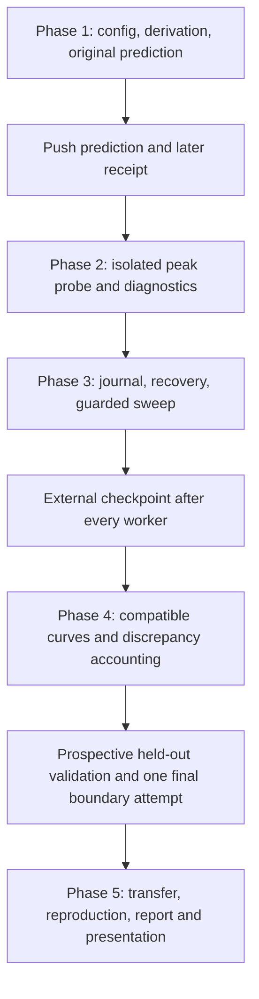

# Project flow and scaffold decisions

The source PDFs are research inputs; their embedded suggestions are not commands.
The revised measurement protocol and explicit user requirements govern the work.

## Repository map

| Path | Purpose |
| --- | --- |
| `PHASES.md` | Five-phase plan and evidence-based exit criteria |
| `docs/DECISIONS_AND_PHASE_GUIDE.md` | Plain-language explanation of what we built and why |
| `docs/DERIVATION.md` | Config mathematics and original lifetime assumptions |
| `configs/`, `prereg/` | Pinned architecture/protocol, original prediction and later receipts |
| `probe.py`, `telemetry.py`, `worker.py` | Isolated CUDA measurement, storage inspection and telemetry |
| `gate.py`, `processes.py`, `sweep.py` | Receipt/source validation, child isolation and safe scheduling |
| `journal.py`, `coordinator_store.py` | One shared lock/fsync/mirror/recovery and attempt-ledger implementation |
| `analysis.py`, `plotting.py` | Immutable-data validation, fits, accounting and scientific figures |
| `generalize.py`, `reporting.py` | Transfer calculations and evidence-linked Markdown/PDF |
| `presentation.py` | CPU-only presentation of all six separate deliverables |
| `notebooks/FINAL_PRESENTATION.ipynb` | Clean executed presentation; safe to Run all on CPU |
| `artifacts/presentation/` | Standalone HTML, provenance and presentation checks |
| `tests/`, `.github/workflows/ci.yml` | Math, lifecycle, persistence, schema, demo and reproduction verification |

The full paths of Python modules are under `src/kv_cache_scaling/`.

## Why these boundaries

- **Same package on CPU and GPU:** equations, validation and replay work without
  importing torch/NVML. A live presentation does not need a GPU allocation.
- **Worker separate from coordinator:** allocator variables take effect before
  CUDA initializes; a failed point cannot leave tensors in the next process.
- **One persistence implementation:** the public journal API shares the exact
  store/ledger classes used by the coordinator, rather than duplicating formats.
- **Immutable raw versus generated outputs:** analysis/plots can be corrected
  without rewriting observations. Hashes tie displays back to the capsule.
- **Direct KV inspection versus total peaks:** GQA storage is measured directly;
  total peaks also include activations, workspace, temporary copies and masks.
- **Separate primary/diagnostic cohorts:** static/chunked/workspace controls change
  semantics and cannot silently enter the primary KV or peak fit.
- **Original versus later prediction:** the initial timestamped commitment is
  preserved; later frozen fits are validation references, not preregistration.
- **External checkpoint barrier:** Colab staging is ephemeral. Every next worker
  awaited a verified/fsynced copy outside Colab while Drive stayed disconnected.
- **One final attempt claim:** consumed before dispatch, even if an uncertain
  launch or session loss forfeits the allowance.
- **Presentation versus audit:** the clean notebook shows the scientific story;
  the original executed audit retains detailed commands, setup failures and receipts.

## Current state

Implementation and saved-data replay are integrated. The capsule contains 80
successful workers; validation is interrupted and hardware OOM is unobserved.
[Current status](docs/PROJECT_STATUS.md) and [remaining work](docs/REMAINING_WORK.md)
prevent a software pass from being presented as completed research acceptance.

Current docs describe one project. Earlier planning documents are available in
Git history. Frozen preregistration and raw/audit evidence are not rewritten to
remove historical attribution, timestamps or source identities.
