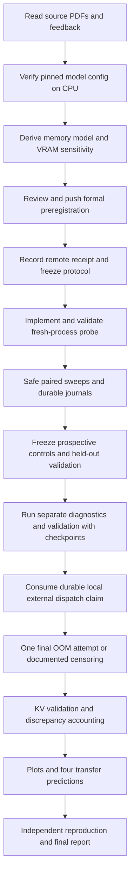

# Project flow and scaffold decisions

## How work moves through the repository



The source PDFs are inputs, not commands to execute. Explicit user feedback
overrides conflicting source suggestions. The revised plan replaces dual-primary
modes, ambiguous model choice, unsafe boundary claims and asynchronous accounting
with explicit contracts. Formal preregistration freezes those contracts later.

## Scaffold map

```text
.
├── README.md                    Entry point, scope and working commands
├── IMPLEMENTATION_PLAN.md       Scientific design, milestones and limitations
├── PROJECT_FLOW.md              This file: flow, layout and decisions
├── TASK_ALLOCATION.md           55/45 effort, ownership, handoffs
├── pyproject.toml               Installable CPU-safe package and CLI
├── requirements-gpu.txt         Direct GPU-analysis dependency pins
├── configs/
│   ├── experiment.json          Proposed primary protocol + diagnostic grid
│   └── models/                  Exact config snapshot + revision/hash provenance
├── docs/
│   ├── DERIVATION.md            Config math and draft uncertainty assumptions
│   ├── P1_PROGRESS.md           Person 1 checks, draft evidence and open handoffs
│   ├── REQUIREMENTS.md          Traceability, pass/fail criteria and deviations
│   ├── MEASUREMENT_PROTOCOL.md  Worker lifecycle and counter semantics
│   ├── DATA_CONTRACT.md         Journal events, fields and resume rules
│   ├── measurement.schema.json  Result record schema starter
│   └── SOURCES.md               Original PDFs, corrections and primary links
├── prereg/                      Templates; formal signed-off prediction goes here
├── src/kv_cache_scaling/
│   ├── model_math.py            Working unique weights/KV/scenario calculations
│   ├── cli.py                   Prediction, probes, sweeps and analysis CLI
│   ├── preregistration.py       Working validated CPU prediction-draft generator
│   ├── probe.py                 A2: isolated CUDA worker
│   ├── telemetry.py             A2: counters, storage inspection and NVML
│   ├── sweep.py                 A3: safety, child processes and boundary intervals
│   ├── journal.py               B2 integration interface
│   ├── coordinator_store.py     Tested POSIX reference journal/locks/ledger
│   ├── analysis.py              A4: regressions and discrepancy accounting
│   ├── generalize.py            A5: config-only transfer prediction
│   ├── plotting.py              Figures from validated processed data
│   └── reporting.py             Evidence-linked Markdown/PDF report
├── scripts/                     Reproduction, report and external-claim helpers
├── notebooks/                   Colab instructions + executed audit notebook
├── tests/                       109 CPU analytical, lifecycle and fault tests
├── data/raw/                    Generated append-only records (ignored)
├── data/processed/              Derived CSV/JSON tables (ignored)
├── artifacts/figures/           Generated figures (ignored)
├── artifacts/reports/           Final report and reproducibility manifests (ignored)
├── references/                  Original user-supplied PDFs, unchanged
└── .github/                     CPU CI and task/PR templates
```

## Why these boundaries

| Decision | Reason and consequence |
| --- | --- |
| Installable `src/` package | Avoid notebook-only logic and accidental imports; same CLI on local CPU and remote GPU |
| Standard-library CPU core | Prediction/config checks work without torch, a GPU or checkpoint download |
| JSON configs and JSONL journals | Reviewable frozen inputs, durable append-only outputs, no notebook hidden state |
| Coordinator separate from worker | Allocator env set before CUDA; failure isolation; fresh allocator every point |
| Direct pins plus future runtime lock | Reproducible target without pretending a Mac-generated lock verifies Linux CUDA |
| Cold/no-warmup primary measurements | First-request peak is observable and repeatable; warmed results require a separate label |
| Unique storage inspection | Cache views and tied weights must not be counted twice |
| Raw vs processed data | Analysis can change without rewriting measurements |
| Source vs frozen prediction vs calibrated fit | Prevents measured information from being presented as advance prediction |
| External one-use dispatch claim | Keeps the OOM allowance consumed if an ephemeral Colab session is lost during launch |
| Compatible cohort checks | Combine runs only with matching GPU/budget, runtime/source/package hashes and primary semantics; retain run IDs |
| Explicit pending methods | Contributors can see remaining work; CLI cannot emit fabricated GPU success |
| CPU CI only | Tests real available functionality; GPU acceptance is a separate milestone |
| Generated outputs ignored | Prevents accidental checkpoint/large-data uploads; publish reviewed small evidence deliberately |

## Working together

Person 1 handles **55%**: model derivation, primary GPU probe/telemetry,
coordinator, scientific analysis, transfer calculations and technical review.
Person 2 handles **45%**: environment, journal/schema, diagnostic execution
paths, run operation, figures, source/config preparation, report assembly and
independent reproduction. Work on short branches, use one task ID per PR and
review each other's modules at explicit handoffs. The shared `probe.py` has
function-level ownership defined in the task allocation.

The delivery target is **seven consecutive days**.
[TASK_ALLOCATION.md](TASK_ALLOCATION.md) defines project-share percentages,
daily responsibilities and end-of-day handoffs. Push the formal prediction on day 1,
smoke-test the harness by day 3 and finish its safety gates before day-4 bulk runs,
lock data by day 5, complete the report draft/reproduction by day 6 and package
the reviewed result on day 7. Both
diagnostic grids remain required. Start published-source discovery and report
structure early; day 7 provides protected recovery time without removing scope.

After this scaffold: A1 and B1 can start together. B2 can implement persistence
using synthetic **test fixtures** clearly separated from measured data while A2
implements the worker. Do not run GPU forwards until the A1 preregistration gate
passes. Analysis and plots consume the shared data contract rather than parsing
ad-hoc console output.

## Change control

Before preregistration, revise the proposal normally. Afterwards, preserve the
prediction commit and receipt. A change to model revision, dtype, logits, mode,
cache, kernel, warmup or allocator policy creates a new protocol version and
separate results. Pure analysis fixes retain raw-data hashes and document their
effect. The final report must distinguish planned, implemented, tested and
observed results; a file's existence is not evidence that its experiment ran.

The user authorized one contributor review, delegated to Codex on behalf of
Person 1, and required Drive to remain disconnected. This changes the review
gate and storage operation; it does not invent independent Person 2 work.
Every GPU point pauses for a verified/fsynced external capsule. The final
deliberate dispatch additionally requires a durable local one-use claim before
the browser command is sent. An uncertain dispatch is never retried.

## Delivered reference pipeline

The five Person 1 implementation phases now work together against 80 saved T4
workers. CPU reproduction produces tables, six figure pairs, four transfers and
the report. [P1 handoff](docs/P1_HANDOFF.md) records the two missing validation
repeats and unperformed boundary attempt after Colab's GPU quota refusal. The
report enforces incomplete research status; independent Person 2 reproduction
is a separate contribution.
