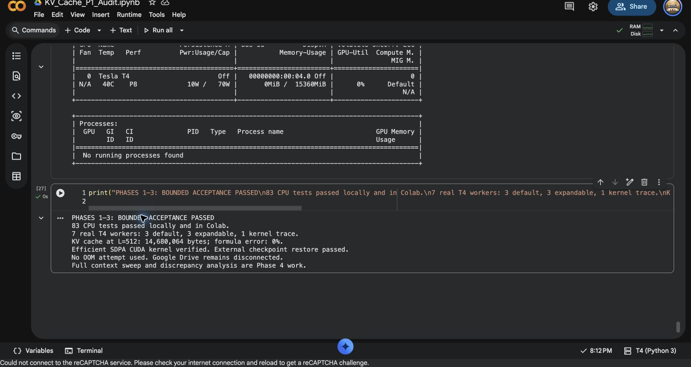

# Person 1 Phases 1–3: bounded acceptance passed

18 October 2026. This closes Person 1's analytical/preregistration, primary
probe and coordinator acceptance under the user-approved amendments below.
It is **not** the project's full context sweep or final research result.

## Verified outcome

- **83 CPU tests passed locally and in the pinned Colab runtime.**
- **Seven real Tesla T4 workers passed:** three default primary L=512 repeats,
  three expandable primary L=512 repeats, and one separate kernel diagnostic.
- Actual unique FP16 parameter storage: **3087428608 bytes**, matching the
  config-derived 1543714304 parameters with the embedding counted once.
- Every cache has **14680064 bytes**, exactly the analytical L=512 prediction.
  Retained allocation minus released allocation also equals 14680064 bytes.
- Reduced logits have shape `(1,1,151936)`, FP16. All synchronized snapshots
  respect reserved >= allocated; forward peaks cover post-forward allocation.
- Profiler records `aten::_scaled_dot_product_efficient_attention`,
  `aten::_efficient_attention_forward`, and the actual SM75 CUDA kernel
  `fmha_cutlassF_f16_aligned_32x128_rf_sm75(...)`.
- Expandable segments ran successfully with the environment set before each
  fresh interpreter. No unsupported-allocator fallback was accepted.
- Every point exited and returned the GPU to idle before another worker started.
  The final driver observation reports no running GPU processes.
- **No deliberate or accidental OOM occurred.** The real global attempt ledger
  remains absent; synthetic CPU fault-test ledgers live in explicitly separate
  test-only directories.

| Primary allocator | Repeats | Peak allocated, bytes (each repeat) | Peak reserved, bytes (each repeat) |
| --- | ---: | ---: | ---: |
| Default | 3 | 3146681856 | 3330277376 |
| Expandable | 3 | 3144715776 | 3164602368 |

These are separately measured maxima. Their subtraction is not a same-time
allocator accounting identity. L=512 differences do not establish a maximum
context improvement, a KV slope, a confidence interval, or threshold accuracy.
The separately profiled diagnostic is excluded from primary comparisons.

## Preregistration and review

Prediction commit:
[`7baff5121ed643f27ba06959065855a8913f8e8c`](https://github.com/DevanshSharma351/KV-Cache-Scaling/commit/7baff5121ed643f27ba06959065855a8913f8e8c).
Later receipt:
[`976158c82ccb10f12817af2ee16b76ade13f0cf3`](https://github.com/DevanshSharma351/KV-Cache-Scaling/commit/976158c82ccb10f12817af2ee16b76ade13f0cf3).
Execution source: `afd86b137fd4e6220b6b23b6bdb4674f64275797`.
Scientific/execution bytes still match the frozen prediction.

Central advance prediction remains **111232 tokens**, with assumption range
**76024–131072**. It has not been calibrated from these acceptance points and
has not been confirmed as an OOM boundary. The model-card quality domain is
32768; the higher domain is synthetic memory stress.

The user authorized one contributor review and explicitly delegated that review
to Codex on behalf of Person 1. Attribution is preserved in the frozen review
and receipt; no independent human or Person 2 approval is invented.

A real preflight failure was preserved, diagnosed and corrected by removing
unused optional torchao 0.10.0 before any model load. The frozen measurement code,
direct scientific versions and numerical baseline stayed unchanged. See
[PREFLIGHT.md](PREFLIGHT.md) and the raw correction archive.

## Persistence and recovery actually tested

Drive stayed disconnected at the user's request. Each acceptance invocation
launched at most one new worker, then returned at an external checkpoint barrier.
Before the next invocation, the full capsule was read from visible notebook
output, SHA-256 checked, every manifest entry verified, and fsynced to local disk.
[transfers.jsonl](transfers.jsonl) records those local persistence barriers.

After the first successful probe, **both** Colab checkpoint directories were
deleted and restored from `restore-checkpoint.zip`, which was repackaged from the
verified local checkpoint and supplied through a visible notebook cell. The next
invocation retained the first result and launched only repeat 2. Existing claims,
requests, result bytes and point keys survived restoration. All seven successful
workers have different PIDs. Finalization launched no eighth worker.

Additional recorded Linux CPU checks passed: forced process exit, volatile-tree
loss, orphan detection, torn suffix preservation and synthetic global-token
refusal. These CPU fixtures are not GPU observations.

This validates the tested external-checkpoint recovery path. **A complete cloud
session/machine restart was not tested.** Colab directories remain ephemeral;
this operator-controlled method is unsuitable for unattended bulk execution.
Person 2's continuous B2 persistence integration remains a bulk-run handoff,
not a completed Person 2 deliverable. No Drive mount durability is claimed.

## Evidence and reproduction

[Executed notebook](https://colab.research.google.com/drive/1GEytpHAffBJog7yi77FJjk-A9t4PedLS).
All commands were added to that same notebook; earlier cells were retained.

| Cells | Evidence |
| --- | --- |
| 17–21 | Pinned-runtime setup, package installation, 77-test original source check, inventory/API evidence |
| 22–25 | 82/83-test reviewed source checks, Linux CPU fault tests, real receipt verification |
| 26–32 | Preserved failed preflight, import diagnosis, optional-package correction and unchanged-budget check |
| 33–34 | First successful model probe, external persistence and loss/restoration of both Colab copies |
| 35–40 | Remaining five primary repeats and separate efficient-kernel trace, one checkpoint per worker |
| 41 | Completed-run finalization with no new worker |
| 42–43 | Final summary and idle driver observation |

`gpu-acceptance-complete.zip` contains 185 checksummed members, including raw
results, requests, claims, manifests, journals, stdout/stderr, package inventories,
CPU fault evidence and the external-restore record. Later summary output is also
preserved in [notebook-summary.txt](notebook-summary.txt). The complete executed
`.ipynb` remains saved at the link; no local executed notebook export is claimed.

Final capsule SHA-256:
`8bbd8f5396e21716c02281df22780e5ad8d699f90ba8843b9e54af8b227cd187`.

Verify on CPU from the repository root:

```bash
.venv/bin/python scripts/verify_p1_acceptance.py \
  artifacts/acceptance/2026-10-18-t4/gpu-acceptance-complete.zip
```

[verification.json](verification.json) records exact per-probe values, GPU UUID,
seven PIDs, frozen source identity and kernel evidence. Historical intermediate
capsules and the failed run remain intact. No model weights or credentials are
included. The transfer ledger and archive hashes preserve the original evidence.
All six between-worker transfer timestamps precede the next worker start.
The verifier also rejected an incomplete six-worker capsule.



## Next work

Phase 4 needs the full length curve, retained-cache slope, allocator safe-limit
comparison and quantitative discrepancy accounting. Phase 5 needs transfer
predictions and report integration. B4 owns bulk run operations; B2 must provide
continuous durable persistence for unattended sweeps. A changed GPU/runtime or
scientific execution module requires its own appropriate preregistration and
receipt; do not pool incompatible runs or edit the original commitment.
